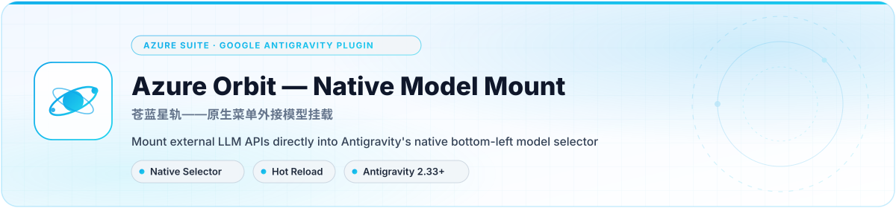
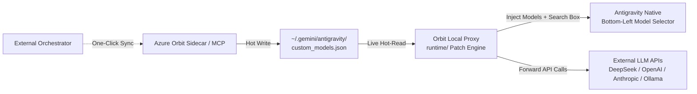

<div align="center">

<p>🌐 &nbsp; <a href="README.md">简体中文</a> &nbsp;·&nbsp; <strong>English</strong></p>

<picture>
  <source media="(prefers-color-scheme: dark)" srcset="assets/readme/hero-en-dark.svg">
  
</picture>

<p>
  <a href="https://github.com/A16Nights/antigravity-azure-orbit/releases"></a>
  <a href="https://github.com/A16Nights/antigravity-azure-orbit/stargazers"></a>
  
  
  
  <a href="./LICENSE"></a>
</p>

<p>
  <strong>Mount DeepSeek, OpenAI, Anthropic, Kimi, OpenRouter, or Ollama directly into Antigravity's native bottom-left model selector as your primary brain</strong>
</p>

<p>
  <a href="#features">✨ Features</a> &nbsp;·&nbsp; <a href="#architecture">🧩 Architecture</a> &nbsp;·&nbsp; <a href="#installation">🚀 Quick Start</a> &nbsp;·&nbsp; <a href="#mcp-tools">🧰 MCP Tools</a> &nbsp;·&nbsp; <a href="#storage">📂 Storage</a> &nbsp;·&nbsp; <a href="#azure-suite">🌌 Azure Suite</a>
</p>

</div>

Native primary-model injection and visual provider management for **Google Antigravity**. Pairs with **[External Orchestrator](https://github.com/A16Nights/antigravity-external-orchestrator)** as the *Azure Twins*: Azure Orbit mounts external models directly into the native selector, while External Orchestrator delegates heavy tasks to external workers.

<table>
<tr>
<td width="50%" valign="top">
<h4>🪐 Native Model Selector Mounting</h4>
One-click <strong>★ Mount / Unmount</strong> any external model into Antigravity's native bottom-left dropdown, with custom aliases and sample cleanup.
</td>
<td width="50%" valign="top">
<h4>🔥 Hot Reload, Zero Restarts</h4>
The local proxy hot-reads <code>~/.gemini/antigravity/custom_models.json</code> on every request—no app restart required (press <code>Ctrl+R</code> if the UI list needs a refresh).
</td>
</tr>
<tr>
<td width="50%" valign="top">
<h4>⚡ One-Click Orchestrator Sync</h4>
Already configured External Orchestrator? Sync all enabled providers, keys, and model lists with a single click—zero duplicate setup.
</td>
<td width="50%" valign="top">
<h4>🛠️ Antigravity 2.32+ / 2.33.0+ Engine</h4>
Fully adapted to the new <code>...spread</code> (<code>baseLsArgs</code>) layout with a built-in search box inside the native dropdown and non-destructive coexisting patches.
</td>
</tr>
</table>

<h2 id="features">
<picture>
  <source media="(prefers-color-scheme: dark)" srcset="assets/readme/sec-features-en-dark.svg">
  
</picture>
</h2>

### 1. Seamless Native Model Selector Mounting
- **Mount Straight into the Native Selector**: Select any external provider model and click **★ Mount / Remove** to expose it directly in Antigravity's bottom-left model dropdown.
- **Hot-Read with Zero Restarts**: The underlying proxy reads `~/.gemini/antigravity/custom_models.json` live on every request; press `Ctrl+R` to refresh the frontend dropdown whenever needed.
- **Custom Aliases & Cleanup**: Assign clear display aliases for mounted models and clear default placeholder entries in one click.

### 2. Multi-Provider Management & Multi-Keyword Model Discovery
- **7 Built-in Provider Presets**: DeepSeek, Local Aggregator Gateway, OpenAI-Compatible, Kimi / Moonshot, OpenRouter, Anthropic-Compatible, and Local Ollama, with custom headers and timeout controls.
- **One-Click `/v1/models` Fetching**: Fetch all available remote models directly in the modal, filter with space-separated multi-keyword queries, and batch-add selected models.
- **Local Key Isolation & Masking**: API keys stay strictly on your machine and are automatically masked in both the UI and MCP responses.

### 3. One-Click Sync with External Orchestrator
- Users of **[External Orchestrator](https://github.com/A16Nights/antigravity-external-orchestrator)** can click **⚡ Sync & Mount from Orchestrator** (or **⇄ Import Providers Only**) to pull all enabled providers, keys, and models automatically.

### 4. Antigravity 2.32+ / 2.33.0+ Runtime Patch Engine (`runtime/`)
- **Modern Argument Layout**: Fully supports `dist/languageServer.js` `...spread` (`baseLsArgs`) injection in Antigravity 2.32+ / 2.33.0+, plus a live search filter inside both Chinese and English native model dropdowns.
- **Non-Destructive Coexistence**: Uses incremental marker injection to coexist cleanly with other extensions; inspect patch status in the panel and generate one-click Desktop install/update or restore scripts.

### 5. Unified Azure Suite UI
- **Sidecar + Standalone Web UI**: Built on Antigravity's official Sidecar + MCP Server architecture; click `Web UI` in the header to manage providers fullscreen in your browser.
- **Neko Glass UI & Azure Theme Center**: Dark/light themes, custom glass dropdowns & modals, 6 official presets + custom dual color pickers + 4 cross-plugin custom slots, sidebar toggle, and GitHub Release update checks.

<h2 id="architecture">
<picture>
  <source media="(prefers-color-scheme: dark)" srcset="assets/readme/sec-arch-en-dark.svg">
  
</picture>
</h2>



<h2 id="installation">
<picture>
  <source media="(prefers-color-scheme: dark)" srcset="assets/readme/sec-install-en-dark.svg">
  
</picture>
</h2>

> **Prerequisite**: **Node.js >= 22.0.0** (zero third-party npm dependencies, pure native ESM).

### Option 1 · Let Antigravity Install It for You (Recommended)

Copy and send the following prompt directly to Antigravity:

> Please clone `https://github.com/A16Nights/antigravity-azure-orbit.git` into my Antigravity global plugins directory as `azure-orbit`, verify the directory structure, and tell me once it is ready so I can press `Ctrl+R` to reload.

### Option 2 · Manual Git Clone

```powershell
# Windows (PowerShell)
git clone https://github.com/A16Nights/antigravity-azure-orbit.git "$env:USERPROFILE\.gemini\config\plugins\azure-orbit"

# macOS / Linux
git clone https://github.com/A16Nights/antigravity-azure-orbit.git ~/.gemini/config/plugins/azure-orbit
```

1. **Restart or reload Antigravity (`Ctrl+R`)**, then open **Azure Orbit** from the sidebar or right-hand panel.
2. **First-time runtime patch**: Open the **Orbit Engine (Runtime Patch)** tab, click **Generate Desktop Install/Update Patch Script**, close Antigravity, and double-click the generated script once.
3. **Mount models**: Add providers (or sync from External Orchestrator), mount desired models to **Native Primary Models**, press `Ctrl+R`, and pick them straight from the bottom-left dropdown.

<h2 id="mcp-tools">
<picture>
  <source media="(prefers-color-scheme: dark)" srcset="assets/readme/sec-tools-en-dark.svg">
  
</picture>
</h2>

| Tool | Description |
| --- | --- |
| `orbit_list_models` | List mounted native models, configured providers (masked), and runtime patch status |
| `orbit_mount_models` | Mount one or more models from a provider directly into Antigravity's native bottom-left dropdown |
| `orbit_unmount_model` | Remove a mounted model from the native dropdown or clear default sample entries |
| `orbit_sync_from_orchestrator` | Sync providers and models from External Orchestrator with optional immediate mounting |
| `orbit_patch_status` | Inspect Antigravity `app.asar` Orbit patch status and version compatibility |

<h2 id="storage">
<picture>
  <source media="(prefers-color-scheme: dark)" srcset="assets/readme/sec-storage-en-dark.svg">
  
</picture>
</h2>

<details open>
<summary><strong>Click to inspect local data paths & shared Azure Suite configs</strong></summary>

<br>

- **Native Mounted Models**: `~/.gemini/antigravity/custom_models.json`
- **Orbit Providers & Settings**: `~/.gemini/azure-orbit/config.json`
- **Shared Azure Suite Theme & Sidebar Config**: `~/.gemini/azure-theme.json`, `~/.gemini/azure-sidebar-nav.json`

</details>

<h2 id="azure-suite">
<picture>
  <source media="(prefers-color-scheme: dark)" srcset="assets/readme/sec-suite-en-dark.svg">
  
</picture>
</h2>

All **8 Azure Suite plugins** share a unified **Neko Glass UI**, synchronized **Azure Theme Center** (`~/.gemini/azure-theme.json`), and customizable **Sidebar Navigation Hub** (`~/.gemini/azure-sidebar-nav.json`):

| Plugin | Repository | Core Capability |
| --- | --- | --- |
| ✦ **External Orchestrator** | [antigravity-external-orchestrator](https://github.com/A16Nights/antigravity-external-orchestrator) | Multi-provider external worker routing, custom profiles, circuit breaker & live monitoring |
| 🪐 **Azure Orbit** &nbsp;`✦ This Repo` | [antigravity-azure-orbit](https://github.com/A16Nights/antigravity-azure-orbit) | Mount external LLM APIs directly into Antigravity's native bottom-left model selector |
| 🧭 **Azure Compass** | [antigravity-azure-compass](https://github.com/A16Nights/antigravity-azure-compass) | Agent mode presets, live context telemetry with auto /compact & Azure Suite sidebar hub |
| 🏛️ **Azure Corridor** | [antigravity-azure-corridor](https://github.com/A16Nights/antigravity-azure-corridor) | Read-only FTS5 conversation search, custom project groups, priority tags & safe archive |
| 🌌 **Lanxi Memory** | [antigravity-lanxi-memory](https://github.com/A16Nights/antigravity-lanxi-memory) | 5-layer Markdown cognitive graph, CJK FTS5, tidal forgetting curves & starfield UI |
| 💎 **Soul.md Studio** | [antigravity-soul-md](https://github.com/A16Nights/antigravity-soul-md) | Hot-swappable persona cards, workspace binding, external-model anchor & layered memory |
| 💭 **Think-ZH** | [antigravity-think-zh](https://github.com/A16Nights/antigravity-think-zh) | Simplified Chinese / English reasoning switcher with dual-channel anti-drift hooks |
| 🔮 **Azure Prism** | [antigravity-azure-prism](https://github.com/A16Nights/antigravity-azure-prism) | Native MCP App Chain-of-Thought viewer with keyless zero-token MT & LLM translation |

---

<div align="center">

📄 Released under the <a href="./LICENSE"><strong>Apache-2.0 License</strong></a> · Crafted for <strong>Google Antigravity</strong>

</div>
