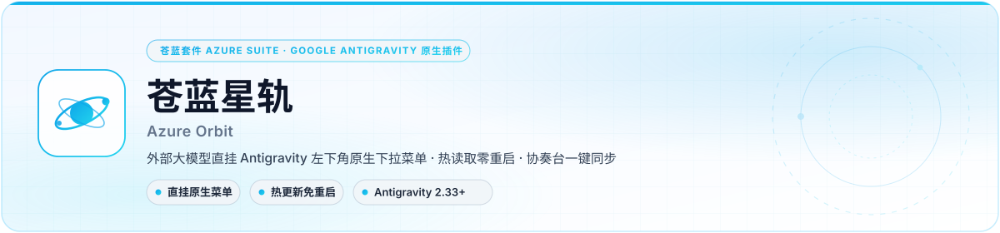
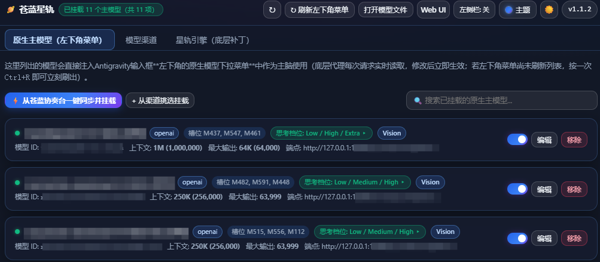
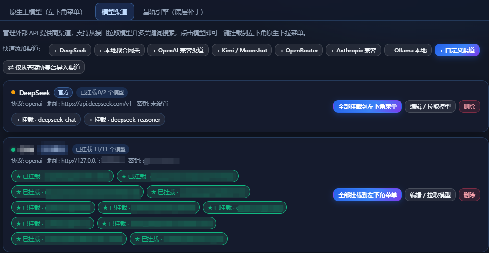
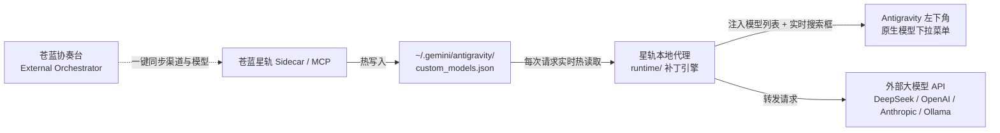

<div align="center">

<p>🌐 &nbsp; <strong>简体中文</strong> &nbsp;·&nbsp; <a href="README.en.md">English</a></p>

<picture>
  <source media="(prefers-color-scheme: dark)" srcset="assets/readme/hero-dark.svg">
  
</picture>

<p>
  <a href="https://github.com/A16Nights/antigravity-azure-orbit/releases"></a>
  <a href="https://github.com/A16Nights/antigravity-azure-orbit/stargazers"></a>
  
  
  
  <a href="./LICENSE"></a>
</p>

<p>
  <strong>苍蓝星轨——原生菜单外接模型挂载 · 将 DeepSeek / OpenAI / Anthropic / Kimi / OpenRouter / Ollama 等外部大模型直接挂载进 Antigravity 左下角原生模型下拉菜单</strong>
</p>

<p>
  <a href="#preview">🖼️ 界面预览</a> &nbsp;·&nbsp; <a href="#features">✨ 功能全景</a> &nbsp;·&nbsp; <a href="#architecture">🧩 工作原理</a> &nbsp;·&nbsp; <a href="#installation">🚀 快速安装</a> &nbsp;·&nbsp; <a href="#mcp-tools">🧰 MCP 工具</a> &nbsp;·&nbsp; <a href="#storage">📂 数据存储</a> &nbsp;·&nbsp; <a href="#azure-suite">🌌 苍蓝全家桶</a>
</p>

</div>

面向 **Google Antigravity** 的原生主模型接入与侧栏可视化管理插件，与 **[苍蓝协奏台（External Orchestrator）](https://github.com/A16Nights/antigravity-external-orchestrator)** 组成「苍蓝双子」：星轨让外部模型直接驶入左下角原生下拉菜单担任主脑，协奏台负责把重度工作委派给外部执行手。

<table>
<tr>
<td width="50%" valign="top">
<h4>🪐 直挂原生模型下拉菜单</h4>
一键 <strong>★ 挂载 / 移除</strong> 任意外部模型到 Antigravity 左下角原生模型选择器，支持自定义显示别名与清理示例占位模型。
</td>
<td width="50%" valign="top">
<h4>🔥 热读取零重启生效</h4>
底层代理每次请求实时热读取 <code>~/.gemini/antigravity/custom_models.json</code>，增删模型无需重启客户端，按 <code>Ctrl+R</code> 即可刷新菜单。
</td>
</tr>
<tr>
<td width="50%" valign="top">
<h4>⚡ 与苍蓝协奏台一键同步</h4>
已配置苍蓝协奏台的用户可一键导入全部已启用提供商、密钥与模型列表并直接挂载，彻底告别重复填写。
</td>
<td width="50%" valign="top">
<h4>🛠️ 适配 2.32+ ~ 2.35+ 补丁引擎</h4>
完整适配新版 <code>...spread</code>（<code>baseLsArgs</code>）启动参数布局，支持原生中/英文下拉菜单实时搜索框与非破坏性共存注入。
</td>
</tr>
</table>

<h2 id="preview">
<picture>
  <source media="(prefers-color-scheme: dark)" srcset="assets/readme/sec-preview-dark.svg">
  
</picture>
</h2>

<table>
<tr>
<td width="50%" align="center" valign="top">
  <a href="assets/readme/preview-models.png"></a>
  <br><strong>原生主模型挂载管理</strong>
  <br><sub>一键从苍蓝协奏台同步并挂载到左下角原生菜单，支持思考档位、Vision 标注与实时检索</sub>
</td>
<td width="50%" align="center" valign="top">
  <a href="assets/readme/preview-providers.png"></a>
  <br><strong>多渠道管理与一键挂载</strong>
  <br><sub>7 大主流渠道快速添加、单模型或整渠道一键挂载到左下角原生下拉菜单</sub>
</td>
</tr>
</table>

<h2 id="features">
<picture>
  <source media="(prefers-color-scheme: dark)" srcset="assets/readme/sec-features-dark.svg">
  
</picture>
</h2>

### 1. 原生模型下拉菜单无缝挂载
- **直挂原生选择器**：选中任意外部渠道模型即可一键 **「★ 挂载 / 移除」** 到 Antigravity 左下角原生模型下拉框。
- **热读取零重启**：底层代理每次请求实时读取 `~/.gemini/antigravity/custom_models.json`，挂载或卸载模型后无需重启客户端（若前端下拉列表尚未刷新，按一次 `Ctrl+R` 即可刷出最新模型）。
- **自定义显示别名与排序**：支持为挂载的模型设置清晰的显示名称，并一键清理默认示例占位模型。

### 2. 多渠道管理、模型拉取与多关键词检索
- **7 大主流预设开箱即用**：内置 DeepSeek、本地聚合网关、OpenAI 兼容、Kimi / Moonshot、OpenRouter、Anthropic 兼容、Ollama 本地预设，支持自定义请求头（Headers）与超时设置。
- **一键拉取 `/v1/models`**：在渠道弹窗或列表中直接从远端接口拉取全部可用模型，支持空格分隔的多关键词实时过滤检索、单选/全选批量添加。
- **密钥隔离与自动脱敏**：API Key 仅保存在本机配置中，界面展示与 MCP 工具返回均自动掩码脱敏。

### 3. 与「苍蓝协奏台」一键双向同步
- 已配置 **[苍蓝协奏台](https://github.com/A16Nights/antigravity-external-orchestrator)** 的用户，只需点击 **「⚡ 从苍蓝协奏台一键同步并挂载」**（或「⇄ 仅从苍蓝协奏台导入渠道」），即可自动导入所有已启用的提供商渠道、密钥与模型列表，免去重复填写。

### 4. Antigravity 2.32+ ~ 2.35+ 底层补丁引擎（`runtime/`）
- **新版参数布局完整适配**：完美适配 `dist/languageServer.js` 在 Antigravity 2.32+ / 2.33.0+ / 2.35+ 下的 `...spread`（`baseLsArgs`）启动参数注入，并在原生中文/英文模型下拉菜单内提供实时搜索框。
- **非破坏性共存注入**：采用增量标记注入，与其他扩展补丁完全共存；支持在侧栏面板实时查看补丁状态，并一键在桌面生成「安装/更新星轨补丁」与「还原官方原版」批处理脚本。

### 5. 苍蓝统一视觉与交互体系
- **Sidecar + 独立 Web UI 双形态**：采用 Antigravity 官方标准 Sidecar 辅助侧栏 + MCP Server 架构，彻底告别传统 Settings 弹窗 DOM 注入失效问题；点击顶栏 `Web UI` 可在系统浏览器全屏管理。
- **Neko Glass 毛玻璃界面 & 苍蓝主题色调中心**：支持深色/浅色切换、自定义毛玻璃下拉框与弹窗、6 套官方主题预设 + 自定义主副双色 + 4 个自定义栏位跨插件同步、左侧栏快捷入口开关与 GitHub Release 在线更新检查。


### 首次使用交互式新手引导（`? 指南`）
- **3 步上手教程 + 真实控件定位高亮**：首次打开面板自动弹出分步功能指南，点击「🎯 定位」按钮可在当前界面脉冲高亮对应控件并附带浮动返回条。
- **本机持久化不复弹**：已读状态保存至 `~/.gemini/azure-onboarding.json`（Sidecar 重启换端口不复弹），日后随时可点击顶栏 **`? 指南`** 重看。

<h2 id="architecture">
<picture>
  <source media="(prefers-color-scheme: dark)" srcset="assets/readme/sec-arch-dark.svg">
  
</picture>
</h2>



<h2 id="installation">
<picture>
  <source media="(prefers-color-scheme: dark)" srcset="assets/readme/sec-install-dark.svg">
  
</picture>
</h2>

> **前置要求**：**Node.js >= 22.0.0**（零第三方 npm 运行时依赖，纯 Node.js 原生 ESM 实现）。

### 方式一 · 一句话让 Antigravity 帮你自动安装（推荐）

直接把下面这句话发给 Antigravity 即可自动完成克隆与核验：

> 帮我把 `https://github.com/A16Nights/antigravity-azure-orbit.git` 克隆到本机 Antigravity 全局插件目录，目录名设为 `azure-orbit`，检查目录无误后告诉我，我再按 `Ctrl+R` 重载生效。

### 方式二 · 命令行手动克隆

```powershell
# Windows (PowerShell)
git clone https://github.com/A16Nights/antigravity-azure-orbit.git "$env:USERPROFILE\.gemini\config\plugins\azure-orbit"

# macOS / Linux
git clone https://github.com/A16Nights/antigravity-azure-orbit.git ~/.gemini/config/plugins/azure-orbit
```

1. **重启或重载 Antigravity（`Ctrl+R`）**，在右侧辅助面板或左侧栏打开 **「苍蓝星轨」**。
2. **首次激活底层补丁**：切换到 **「星轨引擎（底层补丁）」** 标签页，点击 **「在桌面生成安装/更新星轨补丁.bat」**，退出 Antigravity 后双击运行一次即可完成注入。
3. **挂载主模型**：在 **「模型渠道」** 页添加渠道或从苍蓝协奏台一键同步，点击模型将其挂载到 **「原生主模型」**，按 `Ctrl+R` 重载窗口后即可在左下角模型菜单中直接选用。

<h2 id="mcp-tools">
<picture>
  <source media="(prefers-color-scheme: dark)" srcset="assets/readme/sec-tools-dark.svg">
  
</picture>
</h2>

| 工具名 | 作用 |
| --- | --- |
| `orbit_list_models` | 查看当前已挂载到左下角原生菜单的主模型、已配置渠道（脱敏）及底层补丁状态 |
| `orbit_mount_models` | 将指定渠道的一个或多个模型直接挂载到 Antigravity 左下角原生下拉菜单 |
| `orbit_unmount_model` | 从左下角原生下拉菜单移除指定模型，或一键清理默认示例模型 |
| `orbit_sync_from_orchestrator` | 一键从「苍蓝协奏台」同步渠道与模型配置并可选直接挂载到原生菜单 |
| `orbit_patch_status` | 检查 Antigravity 客户端 `app.asar` 的星轨底层补丁安装状态与版本兼容性 |

<h2 id="storage">
<picture>
  <source media="(prefers-color-scheme: dark)" srcset="assets/readme/sec-storage-dark.svg">
  
</picture>
</h2>

<details open>
<summary><strong>点击展开查看本机数据目录与苍蓝套件共享配置路径</strong></summary>

<br>

- **原生挂载模型列表**：`~/.gemini/antigravity/custom_models.json`
- **星轨渠道与配置**：`~/.gemini/azure-orbit/config.json`
- **苍蓝套件共享主题 / 左侧栏配置**：`~/.gemini/azure-theme.json`、`~/.gemini/azure-sidebar-nav.json`

</details>

<h2 id="azure-suite">
<picture>
  <source media="(prefers-color-scheme: dark)" srcset="assets/readme/sec-suite-dark.svg">
  
</picture>
</h2>

**苍蓝套件（Azure Suite）** 11 款插件共享统一的 **Neko Glass 毛玻璃界面**、跨插件同步的 **苍蓝主题色调中心**（`~/.gemini/azure-theme.json`）以及可自由开关的 **左侧栏快捷入口**（`~/.gemini/azure-sidebar-nav.json`）：

| 插件 | 仓库 | 核心能力 |
| --- | --- | --- |
| ✦ **苍蓝协奏台——外部模型调度与省流** | [antigravity-external-orchestrator](https://github.com/A16Nights/antigravity-external-orchestrator) | 多渠道外部模型协同调度、自定义调度角色、容灾断路器、全链路监控与首次新手引导 |
| 🪐 **苍蓝星轨——原生菜单外接模型挂载** &nbsp;`✦ 当前仓库` | [antigravity-azure-orbit](https://github.com/A16Nights/antigravity-azure-orbit) | 将外部大模型直接挂载进 Antigravity 左下角原生模型下拉菜单担任主脑 |
| 🧭 **苍蓝罗盘——Agent 预设与上下文监控** | [antigravity-azure-compass](https://github.com/A16Nights/antigravity-azure-compass) | Agent 工作模式预设中心、上下文水位监测与自动 /compact、苍蓝套件左侧栏总控 |
| 🏛️ **苍蓝回廊——会话与工作区管理** | [antigravity-azure-corridor](https://github.com/A16Nights/antigravity-azure-corridor) | 纯官方原生会话与工作区同步、FTS5 全文检索、自选快捷标签栏、跨工作区转移续聊与新手引导 |
| 🌌 **蓝汐——认知图谱长期记忆** | [antigravity-lanxi-memory](https://github.com/A16Nights/antigravity-lanxi-memory) | 五层纯 Markdown 真源记忆、CJK FTS5、潮汐遗忘曲线与交互式潮汐星海图谱 |
| 💎 **苍蓝魂匣——人设卡与分层记忆** | [antigravity-soul-md](https://github.com/A16Nights/antigravity-soul-md) | 多人设卡热切换、工作区专属绑定、外接模型智能防掉线锚点与分层文件记忆 |
| 💭 **思语中文——外接模型中文思考切换** | [antigravity-think-zh](https://github.com/A16Nights/antigravity-think-zh) | 外接推理模型内部思考简体中文 / 英文热切换、双通道防漂移与实时注入预览 |
| 🔮 **苍蓝棱镜——思维链观测与实时翻译** | [antigravity-azure-prism](https://github.com/A16Nights/antigravity-azure-prism) | 原生 MCP App 思维链实时观测、免密钥零 Token 机翻与外部模型双通道译文 |
| 🪄 **苍蓝魔杖——Windows 桌面与网页操控** | [antigravity-azure-wand](https://github.com/A16Nights/antigravity-azure-wand) | Windows 桌面与网页低打扰操控台、独立输入 15 状态 AI 光标、套装画廊混搭与外部光标导入 |
| 🍃 **苍蓝流笺——拖拽发图与原生文件标签** | [antigravity-azure-drop](https://github.com/A16Nights/antigravity-azure-drop) | 零 `app.asar` 侵入、拖拽与粘贴插入原生文件标签、无损 PNG 截图落盘、图片缩略图灯箱与面包屑右键菜单 |
| 🔭 **苍蓝星瞳——多账号 Gemini 网页副脑** &nbsp;`Beta` | [antigravity-azure-lens](https://github.com/A16Nights/antigravity-azure-lens) | 1:1 原生双态 Gemini 侧栏、双标签物理隔离、多账号独立 Profile 自动检测、免跳转内部弹窗与 MCP 静默调研审阅 |

---

<div align="center">

📄 Released under the <a href="./LICENSE"><strong>Apache-2.0 License</strong></a> · Crafted for <strong>Google Antigravity</strong>

</div>
